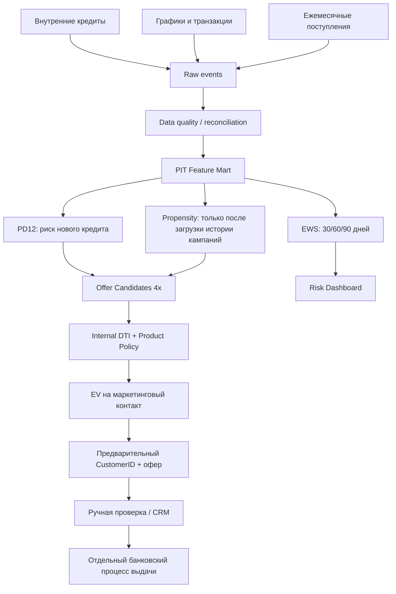

# Целевая архитектура v6

## 1. Границы проекта

**Включено:** история внутренних кредитных договоров, графики погашения, фактические платежи, поступления/расходы в рамках одного банка, локальные модельные скоры и предварительный выбор аудитории.

**Не включено:** кредитные бюро, внешние обязательства, проверка самозапрета, нормативное подтверждение полной ПДН, отправка рекламы, автоматическое согласование/выдача. Проверка самозапрета перед фактическим подписанием — ответственность отдельного кредитного процесса банка. Отсутствие такой проверки **здесь** не означает, что она не обязательна.

## 2. Схема

## 3. Data mart

| Таблица | Ключ/гранулярность | Применение |
|---|---|---|
| customers.csv | CustomerID | Атрибуты клиента |
| loans.csv | CreditID | Договор, продукт, сумма, дата выдачи |
| repayment_obligations.csv | CreditID + InstallmentNo | Плановый долг и дата платежа |
| repayment_transactions.csv | PaymentID | Реальные (в этом наборе сценарные) операции и частичные погашения |
| customer_monthly_activity.csv | CustomerID + MonthEnd | Поступления, расходы, активность |
| early_warning_snapshots.csv | CreditID + SnapshotDate | 351 263 point-in-time наблюдения |
| model_dataset.csv | CreditID | Признаки на дату выдачи, Target на 12 месяцев |
| marketing_candidates.csv | CustomerID + SnapshotDate | Клиенты без активных кредитов |
| internal_marketing_events.csv | CustomerID + OfferDate + ProductCode | Будущий источник отклика/конверсии; сейчас без строк |

**Point-in-time:** агрегаты берутся только из прошлых событий, недоступные ещё будущие метки `TargetNewDPD30_*` записываются `NaN`. События ДПД30 в future window рассчитываются на метках отдельно от features. Train и калибровка выполняются на завершённых исторических периодах, OOT тест — более поздний.

## 4. Риск для новых выдач

- `TargetDPD30_12M=1`, если после выдачи за 12 месяцев случается хотя бы один DPD >=30.
- Дата оценки — момент выдачи, нет будущих платежей в признаках.
- Logistic Regression со стандартизацией и калибровкой сигмоидой на отдельной временной когорте.
- OOT 2025, сохранена calibration table. География/CustomerID не входят в признаки.
- Ограничения: смещение отбора ранее одобренных заёмщиков, сложность использования для клиентов без истории, искусственно сгенерированные вероятности.

## 5. Early Warning (действующие кредиты)

- `TargetNewDPD30_{30,60,90}D`: кредит с DPD <30 на дату T достигает DPD>=30 между T и T+h. Уже DPD>=30 исключён из задачи новых событий.
- Features: DPD на T, время кредита, платежи 6М, сумма, ставка, текущая внутренняя нагрузка и поступления до T.
- TRAIN: снимки 2023–2024; CALIB: 2025 апрель–июнь; OOT: 2025 октябрь–2026 март; prod model refit 2023–2025, calibration 2026 апрель–июнь (все метки вызрели до даты наблюдения).
- В отчёте показаны ROC-AUC, PR-AUC, Brier, reliability, ablation и drift. 30-дневный ROC-AUC сильно зависит от близости текущего DPD к 30; реальное качество требуется проверить на отдельной базе.
- Для оценки убытка применяется **сценарная** конверсия вероятности DPD30+ в потери (LGD), а не бухгалтерская модель ECL.

## 6. Предварительный Decision Engine

1. На дату среза выбрать клиентов без активных внутренних кредитов.
2. Создать четыре офера (два онлайн по разным срокам, обычный наличный, рассрочка). Не предлагать залог, авто и ипотеку без подтверждения цели и залога.
3. Вычислить доступную сумму из внутреннего ПДН: `max_payment = max(0, income×max_dti - active_internal_payments)`; из этого определить сумму аннуитета.
4. Рассчитать `PD12` на условиях каждого офера, отклонить рисковые/недоступные альтернативы.
5. Оценить чистую экономику **при выдаче**, затем `EV/contact = scenario P(accept)×contribution - contact cost`.
6. Выбрать лучший положительный офер на одного `CustomerID` с необязательным лимитом доли продуктов.
7. Экспортировать `PRE_OFFER_REVIEW`; не считать офер согласованным, сохранять неизвестные статусы согласия, внешнего долга и самозапрета.

**ПДН внутренний — не итоговый регуляторный ПДН.** Проверка общей платёжеспособности, документов и обязательных процедур — в основном процессе банка до заключения договора.

## 7. Данные о продажах/контактах

Если когда-либо добавляются внутренние события CRM, объединять их по CustomerID с признаками на дату офера. Поля `OfferDate`, `ProductCode`, `Contacted`, `AcceptedWithin30D`, `MarketingConsentAtOffer`. При отсутствии исходов конверсию 8% считать **внешней сценарной переменной**, не прогнозом. Возможный uplift требует A/B-контроля, propensity alone не оценивает причинный эффект контакта.

## 8. Model Governance / ограничения

- `reports/model_registry_v6.json`: версия, дата, доступные источники, метрики, ограничения.
- `reports/ews_oot_validation.csv`, `credit_risk_oot_validation.csv`: независимые временные тесты.
- `reports/ews_psi.csv`: контроль сдвига распределений; PSI >0.25 — индикатор необходимости анализа, а не автоматический юридический критерий.
- `reports/ews_vintage.csv`, `ews_roll_rates.csv`: зрелость портфеля и миграция DPD.
- `reports/ews_ablation.csv`: изменение PR-AUC/Brier от финансового обогащения.
- `reports/credit_risk_calibration.csv`: проверка PD vs фактическая доля риска.
- Не вызывать `CustomerID`/`City`/`Region` как предикторы риска и ценообразования; по географии проводить только дескриптивную оценку качества и концентраций.
- Повторить OOT и калибровку на реальных исторических данных перед любыми операционными действиями.

## 9. Дальнейшая техническая интеграция

Подключение новых данных — отдельная таблица с бизнес-ключом, временем события и временем доступности. Не заменять историческое значение современным. Для обновления локальных CSV использовать `python -m scripts.refresh_project`; при новом конце истории настроить `ASOF` в коде (в этой версии зафиксирован 31.10.2026). В проде параметры и feature catalog вынести в конфигурацию и хранить модель как версионированный артефакт, не обучать по каждому запросу UI.
